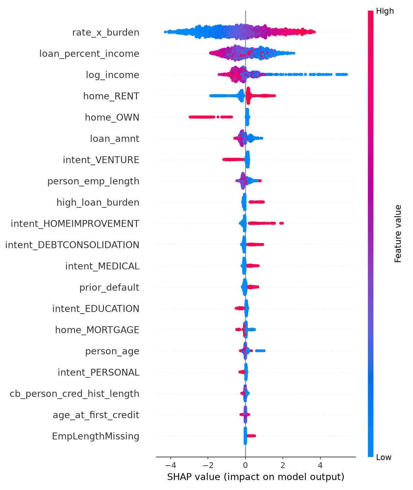

# Credit Risk Scoring - Probability of Default Model

Predicts the probability that a loan applicant will default and maps it to a Low / Medium / High risk band. Built on the Kaggle **Credit Risk Dataset** (32,581 loans, ~21.8% default rate; target `loan_status`, 1 = default).

**Live demo:** [add Streamlit link]

## Problem
Banks must estimate how likely a borrower is to default before lending. Defaults are the minority class, so plain accuracy is misleading; this project is judged on AUC, PR-AUC, KS and precision/recall instead.

## Approach
1. **Cleaning:** removed 170 duplicate rows and impossible values (ages above 100, 123 years of employment); imputed missing interest rates by loan grade and missing employment length by median, with missing-value flags; capped extreme incomes at the 99th percentile.
2. **Features:** log income, loan-to-income burden flag, ordinal loan grade, prior-default flag, one-hot home ownership and loan purpose.
3. **Models:** Logistic Regression baseline vs XGBoost, stratified 80/20 split. Class weights were deliberately not used so predicted probabilities stay calibrated (mean predicted PD 21.9% vs actual 21.9%).
4. **Evaluation:** AUC, PR-AUC, KS statistic, and precision/recall at an F1-optimised threshold.
5. **Risk bands:** bottom 50% of predicted risk = Low, next 30% = Medium, top 20% = High.
6. **Explainability:** SHAP summary plot of the factors driving risk.

## Results (test set, 6,483 loans)
| Model | AUC | PR-AUC | KS | Precision | Recall |
|---|---|---|---|---|---|
| Logistic Regression | 0.882 | 0.741 | 0.627 | 0.70 | 0.69 |
| XGBoost | 0.944 | 0.900 | 0.751 | 0.98 | 0.72 |

| Risk band | Share of loans | Actual default rate |
|---|---|---|
| Low | 50% | 2.3% |
| Medium | 30% | 12.0% |
| High | 20% | 85.7% |

Top drivers (SHAP): loan grade, income, loan amount relative to income, interest rate, and home ownership.



## Limitations
- Single public dataset with no time dimension, so no out-of-time validation.
- Loan grade and interest rate are set by the lender during underwriting, so they are strong predictors but would not be available at the very first screening step of a real application.
- Threshold maximises F1; a real bank would set it from the cost of a missed default versus a rejected good customer.
- Demo only; not for real lending decisions.

## Run it
```
pip install -r requirements.txt
# put the CSV at data/cs-training.csv
python train.py
python -m streamlit run app.py
```
